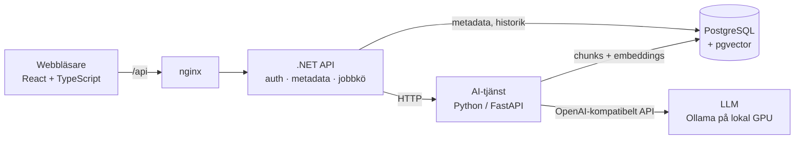

# Kommunkoll – fråga svenska kommundokument

Ladda upp kommunala protokoll och beslutsunderlag (PDF) och ställ frågor på svenska. Svaren bygger på dokumentens innehåll (RAG) och visar exakt **vilket dokument och vilken sida** de kommer från. Klicka på en källa så öppnas originalet på rätt sida.

> **Status: fas 1 av 5 klar** – hela flödet fungerar lokalt end-to-end (uppladdning → bakgrundsindexering → fråga → svar med källa). Inloggning, utvärdering av svarskvalitet, live-demo och polering återstår. Se [projektplanen](docs/projektplan.md).

<!-- TODO (fas 5): live-demo-länk, skärmbild/GIF, CI-badge -->

## Funktioner (hittills)
- Dra-och-släpp-uppladdning av flera PDF:er med status i realtid (i kö → bearbetas → klar/misslyckades) och möjlighet att försöka igen.
- Chatt med källhänvisningar: numrerade `[1]`-markeringar i svaret öppnar PDF:en på den citerade sidan.
- Svaret säger **"Jag hittar inget stöd i dokumenten"** i stället för att gissa när underlaget saknas.
- Ljust/mörkt läge, responsivt ner till mobil, tillgänglighetsanpassat (tangentbord, aria, reducerad rörelse).
- Tydligt offline-läge när AI-modellen inte är tillgänglig (dokumenten går fortfarande att bläddra bland).
- Dataisolering per ägare i varje vektorfråga (bevisas av automatiskt test).
- **Svenska tecken (Å, Ä, Ö) hanteras hela vägen.** All extraherad text och alla frågor normaliseras (Unicode NFKC): sönderdelade tecken (a + ¨, vanligt från macOS/Word) sätts ihop och typografiska ligaturer (fi, fl) skrivs ut, annars missar sökningen t.ex. "finansiering". NUL-tecken tas bort så att Postgres inte avvisar texten. Filnamn med åäö skickas RFC 5987-kodade mellan tjänsterna.

## Arkitektur



| Del | Teknik | Ansvar |
|---|---|---|
| `frontend/` | React 19, TypeScript, Vite, Tailwind 4, TanStack Query | Gränssnitt, PDF-visning, offline-hantering |
| `backend/` | .NET 10, minimal API, EF Core, Npgsql | Dokument- och chatt-API, filer, bakgrundsbearbetning, felhantering (ProblemDetails) |
| `ai-service/` | Python 3.12, FastAPI, pypdf, sentence-transformers | PDF → text per sida → chunks → embeddings → sökning → svar |
| Databas | PostgreSQL 17 + pgvector | Metadata (schema `public`) och vektorer (schema `rag`) |
| LLM | Ollama (lokal modell) bakom ett eget interface | Svarsgenerering, utbytbar leverantör |

Varför två backend-tjänster och varför pgvector: se [ADR 0001](docs/adr/0001-dotnet-gateway-and-python-ai-service.md) och [ADR 0002](docs/adr/0002-pgvector-instead-of-separate-vector-db.md).

### Hur ett svar tas fram
1. Fråga och (valfritt) dokumentfilter går till .NET, som lägger på ägarens id.
2. AI-tjänsten embeddar frågan och hämtar de mest lika chunkarna **bara för den ägaren**.
3. Chunkarna, numrerade med sidnummer, läggs i en prompt som instruerar modellen att svara enbart utifrån utdragen, hänvisa med `[n]` och behandla dokumenttext som data, inte instruktioner.
4. Svar + källor (dokument, sida, utdrag) sparas i historiken och returneras.

## Köra lokalt

Krav: Docker (Engine eller Desktop). För utveckling utan containrar även .NET 10 SDK, Node 22 och Python 3.12. Se [docs/dev-setup.md](docs/dev-setup.md) för uppsättning på Windows/WSL2 och för att arbeta på flera datorer.

```bash
cp .env.example .env      # fyll i lokala värden
docker compose up --build
```

- Frontend: http://localhost:3000
- API-dokumentation (Scalar): http://localhost:8080/scalar
- AI-tjänst: http://localhost:8000/docs

Utan GPU, kör med de falska backends som finns för utveckling (`EMBEDDING_BACKEND=fake`, `LLM_BACKEND=fake` i `.env`). Det ger ett fungerande flöde utan riktiga svar. För riktiga svar: kör Ollama och sätt `LLM_BACKEND=ollama`, `LLM_MODEL` och `OLLAMA_BASE_URL`.

### Utveckla tjänst för tjänst
```bash
docker compose up -d db                                   # databasen
cd ai-service && python -m venv .venv && .venv/Scripts/pip install -r requirements-dev.txt
EMBEDDING_BACKEND=fake LLM_BACKEND=fake .venv/Scripts/python -m uvicorn app.main:app --port 8000
cd backend/src/DocAssistant.Api && dotnet run --urls http://localhost:5174
cd frontend && npm install && npm run dev                 # http://localhost:5173
```
Frontend-dev-servern proxar `/api` till .NET-API:et, så allt är same-origin.

## Tester

| Del | Kommando | Vad som testas |
|---|---|---|
| `ai-service` | `pytest` | Chunking (sidnummer bevaras, ingen text tappas), PDF-parsning, hela API-flödet mot riktig Postgres, **dataisolering mellan ägare**, omindexering, radering, **svenska tecken** (PDF med inbäddat typsnitt, sönderdelade accenter, ligaturer, versaler/gemener, filnamn) |
| `backend` | `dotnet test` | Hela API:et via `WebApplicationFactory` mot en egen engångsdatabas i Postgres: uppladdning och bakgrundsbearbetning, validering (innehåll, storlek), AI-fel → rätt statuskod, retry, radering, chatt och historik |
| `frontend` | `npm test` | API-felhantering (ProblemDetails, nätverksfel), källhänvisningar i svar, uppladdningsvalidering, formatering |

Integrationstesterna kräver att databasen körs (`docker compose up -d db`). CI ([.github/workflows/ci.yml](.github/workflows/ci.yml)) kör alla tre delarna med en Postgres-tjänst.

## API i korthet

| Metod | Sökväg | Beskrivning |
|---|---|---|
| `POST` | `/api/documents` | Ladda upp PDF (svarar `202`, bearbetas i bakgrunden) |
| `GET` | `/api/documents` | Lista dokument med status |
| `GET` | `/api/documents/{id}/file` | Originalfilen (inline, för PDF-visaren) |
| `POST` | `/api/documents/{id}/retry` | Kör om ett misslyckat dokument |
| `DELETE` | `/api/documents/{id}` | Ta bort dokument, vektorer och fil |
| `POST` | `/api/chat` | Ställ en fråga |
| `GET` | `/api/chat/history` | Tidigare frågor och svar |
| `GET` | `/health` | Status för databas och AI-tjänst |

Fel returneras som RFC 7807 ProblemDetails. `503` med `code: "ai_unavailable"` betyder att AI-modellen inte kan nås.

## Kända begränsningar (just nu)
- En demoanvändare delar allt. Riktig inloggning (JWT) och användarisolering i API-lagret kommer i fas 2; isoleringen i vektorsökningen finns redan.
- Skannade PDF:er (utan textlager) stöds inte; användaren får ett tydligt felmeddelande. OCR är en möjlig förbättring.
- Svarskvaliteten är inte mätt än och tröskeln för "inget stöd" är avstängd. Det är fas 3 (utvärdering med frågeset, retrieval-mått och jämförelse av chunking/modeller).
- Svaren strömmas inte än; gränssnittet visar en laddningsindikator.
- Den riktiga embeddingmodellen och Ollama är ännu inte körda i full stack; fas 1 är verifierad med falska backends.

## Projektstruktur
```
frontend/      React-app (+ Dockerfile, nginx)
backend/       .NET-lösning: src/DocAssistant.Api, tests/DocAssistant.Api.Tests
ai-service/    Python/FastAPI-tjänsten och dess tester
eval/          Frågeset och utvärderingsskript (fas 3)
docs/          Projektplan, ADR:er, utvecklingsguide
```
