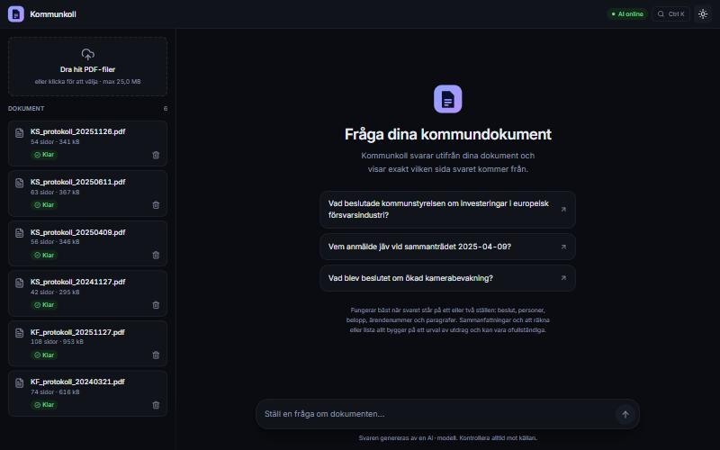
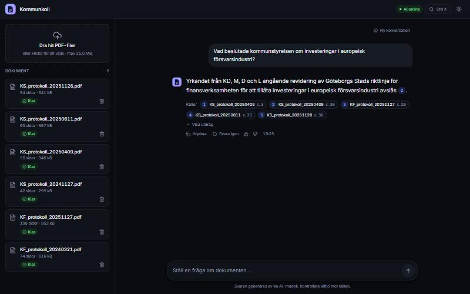
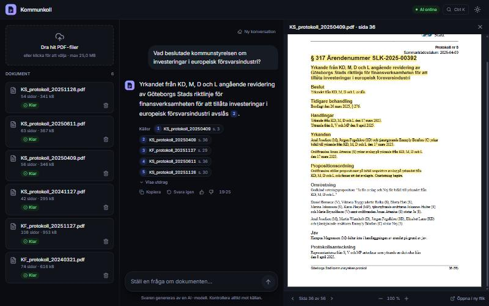
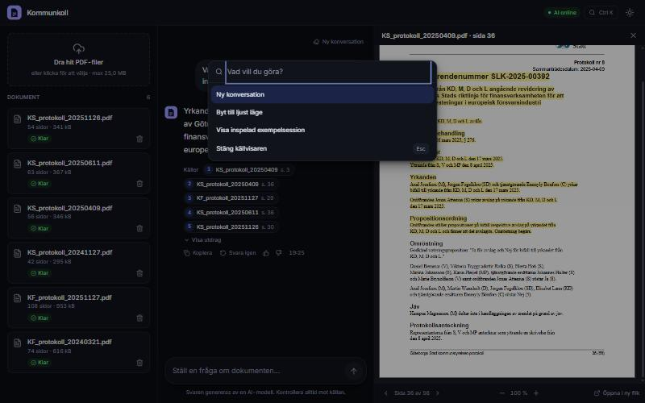
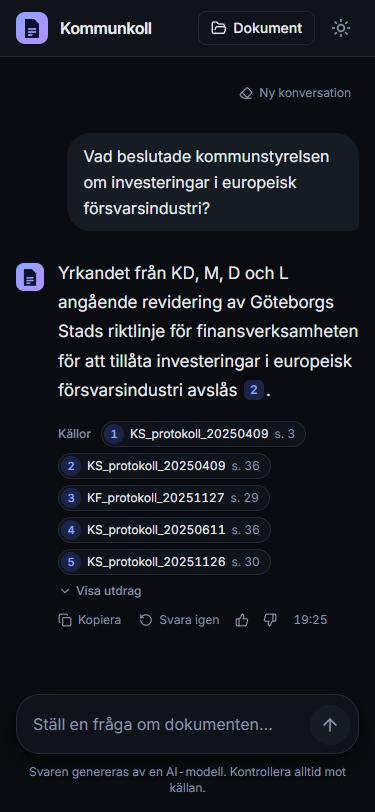
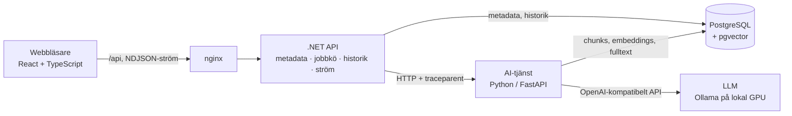

# Kommunkoll – fråga svenska kommundokument

[](https://github.com/n00rp/Rag-Project/actions/workflows/ci.yml)

Ladda upp kommunala protokoll och beslutsunderlag (PDF) och ställ frågor på svenska. Svaren bygger på dokumentens innehåll (RAG), växer fram ord för ord och visar exakt **vilket dokument och vilken sida** de kommer från. Klicka på en källa så öppnas PDF:en bredvid chatten med det citerade stycket markerat.

| | |
|---|---|
|  |  |
|  |  |
|  | |

> **Läge:** allt körs lokalt (språkmodellen på en egen GPU). Det finns ingen inloggning och ingen publik demo än; hosting och inloggning är medvetet uppskjutna. Se [vad som återstår](#vad-jag-skulle-göra-härnäst) och [kända begränsningar](#säkerhet-och-kända-begränsningar).

## Det som skiljer det från en vanlig RAG-demo
Projektet är byggt kring **mätning**. Det finns ett frågeset med facit, uppdelat i en del att tuna mot och en del som sparas för beslut, och varje förändring av sökning eller svar har antingen införts eller förkastats med siffror (se [Utvärdering](#utvärdering)). Det har gett några resultat som inte syns utan mätning:
- Att **rensa upprepade sidhuvuden** (det "uppenbart rätta") *försämrade* sökningen, eftersom sammanträdesdatumet bara står där; lösningen blev att lägga dokumentets rubrik i varje chunk.
- **Ärendenummer och paragrafer** hittades nästan aldrig av vektorsökning (rätt svar i 21 % av fallen). En hybridsökning bara för sådana frågor tog det till 68 % och sökningen från MRR 0,21 till 0,96.
- Fyra andra idéer (hybrid för alla frågor, grannchunkar som kontext, mjukare nekande, strukturerat svar) **förkastades eller stängdes av** eftersom siffrorna inte stödde dem, och det står vad de kostade.
- LLM-domaren är inte pålitlig nog att ensam avgöra små skillnader (domarna är överens i 75–94 % av fallen), vilket redovisas i stället för att döljas.

## Funktioner
- **Strömmande svar** med förlopp (söker, läser utdragen, skriver), stoppknapp, kopiera, "svara igen" och tumme upp/ned med frivillig kommentar. Ett stoppat eller avbrutet svar sparas som det var.
- **Svar i Markdown** (listor, fetstil, tabeller) med numrerade `[1]`-hänvisningar som visar källan vid hovring.
- **Källvisare** som renderar PDF-sidan (pdf.js), markerar det citerade utdraget, rullar dit, zoomar och ligger bredvid chatten på bred skärm.
- **Ärlighet:** svaret säger *"Jag hittar inget stöd i dokumenten"* hellre än att gissa, och märker när ett svar bara bygger på ett urval ("Översikt … kan vara ofullständig").
- **Sök som förstår dokumenten:** frågor med ärendenummer (`SLK-2025-00392`) eller paragraf (`§ 319`) får nyckelordssökning, ett datum i frågan (`2025-04-09`) begränsar sökningen till det sammanträdet, och ett nummer som inte finns i dokumenten nekas direkt.
- Drag-och-släpp-uppladdning av flera PDF:er med status i realtid (i kö → bearbetas → klar/misslyckades) och möjlighet att försöka igen.
- **Genvägar:** `/` fokuserar frågefältet, `Ctrl+K` öppnar en kommandopalett, `↑` hämtar förra frågan, `Esc` stoppar ett svar.
- Ljust/mörkt läge, responsivt ner till mobil, tillgänglighet 100 i Lighthouse (automatiska kontroller).
- **Offline-läge:** när AI-modellen inte är tillgänglig går dokumenten att bläddra bland, och en inspelad exempelsession visar hur svar ser ut.
- **Svenska tecken (Å, Ä, Ö) hela vägen.** All extraherad text och alla frågor normaliseras (Unicode NFKC): sönderdelade tecken (a + ¨, vanligt från macOS/Word) sätts ihop och typografiska ligaturer (fi, fl) skrivs ut, annars missar sökningen t.ex. "finansiering". Filnamn med åäö skickas RFC 5987-kodade mellan tjänsterna.
- **Dataisolering per ägare** i varje vektorfråga (bevisas av automatiskt test).
- **Drift:** start/stopp/säkerhetskopia med ett kommando, strukturerade loggar med ett spårid som följer en fråga genom båda tjänsterna (utan frågetext).

## Arkitektur



| Del | Teknik | Ansvar |
|---|---|---|
| `frontend/` | React 19, TypeScript, Vite, Tailwind 4, TanStack Query, pdf.js | Gränssnitt, strömmande chatt, källvisare, offline-läge |
| `backend/` | .NET 10, minimal API, EF Core, Npgsql | Dokument- och chatt-API, filer, bakgrundsbearbetning, ström, felhantering (ProblemDetails) |
| `ai-service/` | Python 3.12, FastAPI, pypdf, sentence-transformers | PDF → text per sida → chunks → embeddings → sökning → svar |
| Databas | PostgreSQL 17 + pgvector | Metadata (schema `public`) och vektorer + fulltext (schema `rag`) |
| LLM | Ollama (gemma3:12b) bakom ett eget interface | Svarsgenerering, utbytbar leverantör |

Beslut och avvägningar: se [ADR:erna](docs/adr/).

### Hur ett svar tas fram
1. Fråga (och valfritt dokumentfilter) går till .NET, som lägger på ägarens id och ett spårid.
2. AI-tjänsten avgör söksätt: har frågan ett **ärendenummer eller en paragraf** kontrolleras först att numret finns i dokumenten (annars nekas frågan direkt) och sökningen blir en blandning av vektor- och nyckelordssökning; har den ett **datum** söks först bara i det sammanträdets chunks.
3. De bäst matchande chunkarna hämtas **bara för den ägaren**. Är bästa träffen för svag (och inte hittad via ett sällsynt ord) nekas frågan utan att modellen anropas.
4. Chunkarna, numrerade med sida, läggs i en prompt som instruerar modellen att svara enbart utifrån utdragen, hänvisa med `[n]` och behandla dokumenttext som data, inte instruktioner. Översiktsfrågor ("sammanfatta", "hur många yrkanden") får fler utdrag och en instruktion att säga att svaret kan vara ofullständigt.
5. Källorna skickas först, sedan texten ord för ord; det färdiga svaret sparas i historiken (ett stoppat svar sparas som det var).

## Utvärdering
Frågesetet (`eval/evalset.jsonl`) har 143 räknade besvarbara frågor och 44 som saknar svar i dokumenten, uppdelade i **dev** (att tuna mot) och **test** (att avgöra beslut på). Sju översiktsfrågor följs bara för hand. Skripten kontrollerar att varje facit finns i källtexten. **Frågorna är skrivna av utvecklaren och ännu inte granskade av någon annan** (`reviewed: false`), vilket gör siffrorna optimistiska. Allt redovisas med 95 %-intervall i [eval/README.md](eval/README.md).

| Mått (gemma3:12b) | Före etapp 3 | Nu |
|---|---|---|
| Rätt sida bland träffarna, MRR (dev / test) | 0,855 / 0,754 | **0,977 / 0,959** |
| …för frågor med ärendenummer eller § | 0,21 / 0,12 | **0,96 / 0,91** |
| Korrekta svar, strikt (dev / test) | 0,71 / 0,66 | 0,76 / 0,84 (spann upp till 0,87 / 0,93) |
| Korrekta svar på ärendenummerfrågor | 21 % | 68 % |
| Frågor utan svar som nekas | 40 av 40 | **44 av 44** |
| Svarstid, median (varm modell) | 1,1 s | 1,2–1,3 s, första ord efter ca 0,2 s |

**Experimenten:**

| Idé | Utfall |
|---|---|
| Rensa sidhuvuden före chunkning | Försämrade sökningen (datumet försvann). **Lösning:** dokumentrubrik i varje chunk, MRR 0,894 → 0,973 |
| Chunkstorlek 300–1500, överlapp 0–300 | Liten effekt mellan 500 och 1500; 300 något sämre |
| Tröskel för "inget stöd" (`min_score`) | 0,83 på bästa träffen; per träff tappade rätt chunk |
| Hybridsökning för alla frågor | Sämre på vanliga frågor; **infördes bara för frågor med nummer** |
| Mjukare nekande i prompten | Hjälpte inte (förkastat) |
| Grannchunkar som kontext | Netto +1 korrekt svar, förankring sjönk (förkastat) |
| Strukturerat svar `fullt/delvis/inget` | Löste "totalsumman som inte finns" men gav två nya nekanden och sämre test (**byggt, avstängt**) |
| Omrankare, större embeddingmodell | Inte prövat: sökningen är nästan perfekt (MRR 0,96–0,98) på vanliga frågor i det här frågesetet, så det finns inget att mäta mot |

Modeller i RAG-jämförelsen på v1-frågorna: gemma3:12b 93 % korrekt (1,2 s), qwen3:14b 84 % (4,8 s), llama3.1:8b 61 % (0,6 s, nekar nästan var tredje fråga).

## Säkerhet och kända begränsningar
- **En demoanvändare delar allt.** Riktig inloggning (JWT), kvoter och rate limits är inte byggda; isoleringen i vektorsökningen finns och är testad, men inte i API-lagret.
- **Prompt injection:** utdragen markeras som data i prompten, och HTML i svar renderas inte, men detta är inte penetrationstestat.
- **Inget hindrar att personuppgifter i uppladdade dokument hamnar i databasen.** Allt stannar lokalt (ingen extern AI-tjänst), men ingen gallring finns.
- **Frågor som kräver hela dokumentet** (sammanfatta, räkna, lista allt) bygger på ett urval av utdrag, och svaren är instabila (en sammanfattning nekades en gång av tre). De märks som översikter men blir inte fullständiga.
- **Falska antaganden** i frågor ("Varför bifölls…" när det avslogs) rättas bara ibland; ett strukturerat svar som löser det är byggt men avstängt.
- Domaren i utvärderingen är en LLM; kalibrering mot en människa (`eval/calibrate.py`) är förberedd men inte gjord.
- Skannade PDF:er (utan textlager) stöds inte (tydligt felmeddelande); tabeller och spalter extraheras som löpande text.
- Dokumentrubriken bygger på att protokollets första rader är organ och datum; på andra dokumenttyper kan den bli slumpmässig text.
- **Andra dokumenttyper är sämre.** På ett HR-bibliotek (AB 25 med kommentarer, tolv lagar) svarar systemet rätt på 48 av 70 frågor (69 %, mot ca 80 % på protokollen). Korta lagar tränger inte igenom de långa kommentarerna i sökningen; se [eval/README.md](eval/README.md#hr-biblioteket-ab-25-lagar-och-77-frågor). Frågorna är inte granskade av en HR-person.
- Layout: två kolumner som läses rad för rad ordnas om för de sidor där det upptäcks (`ai-service/app/columns.py`), men tabeller med bråk och staplade rubriker (t.ex. övertidsersättningen i AB) läses fortfarande fel.
- Mobil prestanda i Lighthouse är 81 (tillgänglighet och bästa praxis 100); inga manuella tester med skärmläsare.

## Köra lokalt

Krav: Docker (Engine eller Desktop). För utveckling utan containrar även .NET 10 SDK, Node 22 och Python 3.12. Se [docs/dev-setup.md](docs/dev-setup.md) för uppsättning på Windows/WSL2 (Docker Engine i WSL2, Ollama på Windows) och för att arbeta på flera datorer.

```bash
cp .env.example .env      # fyll i lokala värden
docker compose up --build
```

- Frontend: http://localhost:3000
- API-dokumentation (Scalar): http://localhost:8080/scalar
- AI-tjänst: http://localhost:8000/docs

På Windows startar `.\scripts\start.ps1` allt (håller WSL vaken, startar stacken, laddar och värmer upp modellen; första frågan tar då ca 2 s i stället för 17–28 s), `stop.ps1` stoppar, `backup.ps1` / `restore.ps1` tar och återställer en säkerhetskopia.

Utan GPU, kör med de falska backends som finns för utveckling (`EMBEDDING_BACKEND=fake`, `LLM_BACKEND=fake` i `.env`). Det ger ett fungerande flöde utan riktiga svar. För riktiga svar: kör Ollama och sätt `LLM_BACKEND=ollama`, `LLM_MODEL=gemma3:12b` och `OLLAMA_BASE_URL`.

### Utveckla tjänst för tjänst
```bash
docker compose up -d db                                   # databasen
cd ai-service && python -m venv .venv && .venv/Scripts/pip install -r requirements-dev.txt
EMBEDDING_BACKEND=fake LLM_BACKEND=fake .venv/Scripts/python -m uvicorn app.main:app --port 8000
cd backend/src/DocAssistant.Api && dotnet run --urls http://localhost:5174
cd frontend && npm install && npm run dev                 # http://localhost:5173
```
Frontend-dev-servern proxar `/api` till .NET-API:et, så allt är same-origin.

## Demodokument (Göteborgs Stad)

Demosamlingen är sex protokoll från Göteborgs Stad (kommunfullmäktige och kommunstyrelsen, 2024–2025, totalt ca 400 sidor), hämtade från stadens [dokumentportal för nämndhandlingar](https://www4.goteborg.se/prod/intraservice/namndhandlingar/samrumportal.nsf). Det är offentliga handlingar. PDF:erna checkas **inte** in i repot; de hämtas av ett skript så att alla datorer får samma samling.

```bash
python scripts/demo_docs.py fetch                  # laddar ner till data/goteborg/ (hoppar över det som finns)
python scripts/demo_docs.py seed --api http://localhost:8080   # laddar upp till det körande API:et
python scripts/record_demo_session.py              # spelar in svar till den offline-visade exempelsessionen
```

Listan med källor finns i [scripts/demo-docs.json](scripts/demo-docs.json). Innan en publik demo bör samlingen gås igenom för personuppgifter och villkor för återanvändning.

### HR-bibliotek (AB 25 och lagar)
```bash
python scripts/fetch_hr_docs.py --seed     # AB-bilagor och tolv lagar (riksdagen.se, skr.se) till data/hr/, laddas upp till API:et
cd ai-service && python ../eval/hr_check.py --verify   # kontrollerar de 77 HR-frågornas facit mot källtexterna
```
Lagarna hämtas som HTML och skrivs ut till PDF med Chrome/Edge; AB 25 och kommentarerna hämtas från [SKR:s sida](https://skr.se/kollektivavtal/allmannabestammelserab.655.html).

### Vad riktiga protokoll lärde oss
Syntetiska testdokument hittade inte följande, riktiga protokoll gjorde det:
- **Sidhuvuden upprepas på varje sida** ("Protokoll nr 8 / Sammanträdesdatum / Göteborgs Stad kommunstyrelsen protokoll 3 (56)") och späder ut innehållet; de tas bort före chunkning (13–15 % av texten). Första versionen ignorerade alla siffror och tog då även bort `§ 289 Ärendenummer SLK-2025-00035`; nu maskas bara sidans *eget* nummer, och alla §-rubriker och ärendenummer i de sex dokumenten är verifierat bevarade (`ai-service/tests/test_boilerplate.py`). Mätningen visade sedan att datumet i sidhuvudet behövs, och det läggs tillbaka som en rubrik i varje chunk.
- Texten extraheras rent: åäö, inga ligaturer eller trasiga tecken i någon av de sex PDF:erna.
- **Samma ärendenummer förekommer i flera protokoll**, och samma paragrafnummer finns i flera; därför behövs datumfiltret.
- Stora dokument är inget problem: 397 sidor och 602 chunks indexeras på ca 15–20 sekunder med embeddingmodellen på CPU.

## Tester och CI

| Del | Kommando | Antal | Vad som testas |
|---|---|---|---|
| `ai-service` | `pytest` | 112 | Chunking, PDF-parsning, hela API-flödet mot riktig Postgres, **dataisolering mellan ägare**, **svenska tecken**, strömmen och dess fel, hybridsökning, datumfilter, nekande av okända nummer, strukturerat svar, loggning (inga frågetexter) |
| `backend` | `dotnet test` | 35 | Hela API:et via `WebApplicationFactory` mot en egen engångsdatabas: uppladdning, validering, AI-fel → rätt statuskod, chatt, **ström med avbrott och fel mitt i**, betyg, historik, spårid |
| `frontend` | `npm test` | 54 | Strömläsning (delade rader och tecken), hooken för pågående svar (stopp, avbrott), Markdown utan rå HTML, citat-chips, källmatchning, kommandopalett, återkoppling, demosession |
| `eval` | `python eval/run_all.py` | – | Frågeset v2, mått med intervall, domare (kör lokalt; kräver Ollama) |

Integrationstesterna kräver att databasen körs (`docker compose up -d db`). CI ([.github/workflows/ci.yml](.github/workflows/ci.yml)) kör alla tre delarna med en Postgres-tjänst, plus lint (ESLint, ruff, `dotnet format`). Evalen körs inte i CI (den kräver en lokal modell), och det finns inget end-to-end-test i webbläsare.

## API i korthet

| Metod | Sökväg | Beskrivning |
|---|---|---|
| `POST` | `/api/documents` | Ladda upp PDF (svarar `202`, bearbetas i bakgrunden) |
| `GET` | `/api/documents` | Lista dokument med status |
| `GET` | `/api/documents/{id}/file` | Originalfilen (inline, för PDF-visaren) |
| `POST` | `/api/documents/{id}/retry` | Kör om ett misslyckat dokument |
| `DELETE` | `/api/documents/{id}` | Ta bort dokument, vektorer och fil |
| `POST` | `/api/chat` | Ställ en fråga (svaret kommer när det är klart) |
| `POST` | `/api/chat/stream` | Samma, men strömmat som `application/x-ndjson` (en JSON-händelse per rad: `sources`, `support`, `token`, `done`, `error`) |
| `PUT` | `/api/chat/{id}/feedback` | Tumme upp/ned med valfri kommentar |
| `GET` | `/api/chat/history` | Tidigare frågor och svar |
| `DELETE` | `/api/chat/history` | Rensa historiken (dokumenten ligger kvar) |
| `GET` | `/health` | Status för databas och AI-tjänst |

Fel returneras som RFC 7807 ProblemDetails. `503` med `code: "ai_unavailable"` betyder att AI-modellen inte kan nås. Varje svar har `X-Trace-Id`.

## Projektstruktur
```
frontend/      React-app (+ Dockerfile, nginx)
backend/       .NET-lösning: src/DocAssistant.Api, tests/DocAssistant.Api.Tests
ai-service/    Python/FastAPI-tjänsten och dess tester
eval/          Frågeset, mätskript, resultat och granskningsverktyg ([eval/README.md](eval/README.md))
scripts/       Start/stopp/backup (PowerShell), demodokument, inspelning av exempelsession
docs/          Projektplan, förbättringsplan, ADR:er, utvecklingsguide, skärmbilder
```

## Vad jag skulle göra härnäst
Se [docs/forbattringsplan.md](docs/forbattringsplan.md) för detaljer. I korthet:
1. **Låt någon annan granska frågesetet** och kalibrera domarna mot en människas bedömning. Det är den största svagheten i utvärderingen.
2. **Inloggning, kvoter och rate limits** (fas 2) innan någon annan använder verktyget, och en tydlig hantering av personuppgifter.
3. **Hosting:** appen på en gratis moln-VM med modellen på en egen dator via tunnel, med den inspelade sessionen som reserv när GPU:n är av. Beslutet är uppskjutet.
4. **Bättre underlag för översiktsfrågor:** sammanfattningar per ärende som beräknas vid indexering, och en tabellmedveten PDF-tolkning (och OCR) för belopp i tabeller.
5. **Fler dokumenttyper** i frågesetet (årsredovisning, detaljplan, policy) för att se om förbättringarna håller utanför protokoll, och svårare frågor som ger omrankare och större embeddingmodell något att visa upp.

## Beslut (ADR)
- [0001 .NET som gateway och Python för AI](docs/adr/0001-dotnet-gateway-and-python-ai-service.md)
- [0002 pgvector i stället för separat vektordatabas](docs/adr/0002-pgvector-instead-of-separate-vector-db.md)
- [0003 Utvärdera först: frågeset med dev/test, intervall och flera domare](docs/adr/0003-measure-first-eval-method.md)
- [0004 Sökning: dokumentrubrik, tröskel på bästa träffen och hybrid bara för nummer](docs/adr/0004-retrieval-header-threshold-and-hybrid-for-identifiers.md)
- [0005 Strömma svar som NDJSON](docs/adr/0005-stream-answers-as-ndjson.md)
- [0006 Strukturerat svar och översiktsfrågor](docs/adr/0006-structured-answer-and-overview-questions.md)
